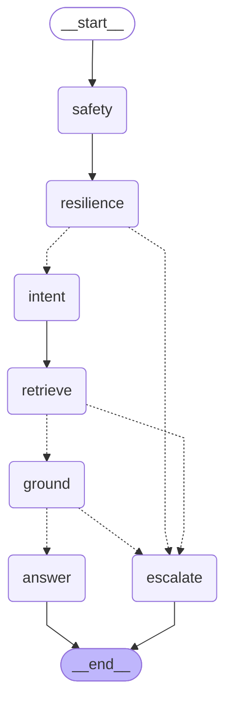

# Multi-Domain Support Triage Agent (LangGraph Architecture)

A deterministic, safety-first support ticket triage agent built with **LangGraph** and **LangChain** for HackerRank, Claude, and Visa enterprise support domains. The agent coordinates stateful execution across discrete stages—safety filtering, input resilience, domain/intent classification, hybrid retrieval, dual-signal grounding verification, and controlled answer building versus human escalation.

---

## 🏗️ LangGraph StateGraph Architecture

The system compiles an auditable StateGraph with conditional routing edges that guarantee zero-hallucination answers and prioritize human escalation on policy, security, authority, or ambiguity flags.



### Discrete Node Responsibility

| Node | Underlying Logic | State Updates |
| :--- | :--- | :--- |
| **`safety`** | Scans for prompt injections, harmful content, and mandatory escalation policies (fraud, account authority, legal, self-harm crisis). | `safety_flag`, `safety_reason`, `request_type` |
| **`resilience`** | Validates character density, noise ratios, empty input, and vague error queries. | `safety_flag`, `safety_reason` |
| **`intent`** | Resolves multi-intents, cross-domain conflicts, and routes domain (Visa, Claude, HackerRank). | `domain`, `intent`, `all_intents` |
| **`retrieve`** | LangChain `BaseRetriever` wrapping BM25 & semantic search with confidence scoring. | `retrieved_chunks`, `confidence`, `confidence_breakdown` |
| **`ground`** | Enforces lexical n-gram matching, semantic similarity, and domain consistency. | `grounded`, `decision_engine_safe` |
| **`answer`** | Formats grounded, actionable responses referencing documented guidance. | `decision`, `status="replied"`, `response`, `justification` |
| **`escalate`** | Routes to human specialist with explainable audit payload and safe guidance. | `decision`, `status="escalated"`, `response`, `justification` |

---

## 📊 Benchmark Evaluation Results

Evaluation performed using `evaluate.py` on an unseen, held-out set of 20 realistic support tickets (`tests/unseen_eval_tickets.csv`) covering answerable FAQs, credential/theft emergencies, contract authority, outages, and out-of-scope queries. Tickets were labelled prior to evaluation and were not tuned on.

**Benchmark Date:** October 29, 2026

| Metric | Result | Analysis |
| :--- | :--- | :--- |
| **Overall Decision Accuracy** | **70.00%** (14/20) | Correct answer vs escalate decision across the held-out set |
| **Retrieval Hit Rate** | **95.00%** (19/20) | Relevant corpus document retrieved in top 3 hits |
| **Escalation Precision** | **100.00%** (TP=4, FP=0) | Every escalated ticket was an authentic human-escalation case |
| **Escalation Recall** | **40.00%** (TP=4, FN=6) | Conservative rules missed 6 nuanced escalations (e.g., proxy cheating, legal entity transfer) |
| **Escalation F1-Score** | **57.14%** | Harmonic mean of precision and recall |
| **Answer Grounding Pass Rate** | **100.00%** (16/16) | All answered tickets verified against retrieved documentation |
| **Execution Determinism** | **100.00%** (29/29) | Identical outputs verified across multiple consecutive runs |

---

## 🔄 Baseline Comparison (Step 5 Match)

On the official `support_issues.csv` dataset (29 tickets), the LangGraph pipeline was compared against a patched copy of the earlier baseline pipeline:

- **Status Decision Agreement:** **22 of 29 tickets (75.9%)**
- **Request Type Agreement:** **29 of 29 tickets (100.0%)**
- **Product Area Agreement:** **24 of 29 tickets (82.8%)**

*(Note: The untouched zip package crashed on Row 1 due to an `AttributeError` on `decision.response`. The pre-packaged `output.csv` bundled in the zip agreed on status on only 17 of 29 tickets [58.6%] with 25 product area mismatches due to earlier prototype formatting).*

### Audit of the 7 Behavioral Differences
The 7 differences represent intentional pipeline behavior changes chosen during graph design:
1. **Row 1 (Claude Access Lost):** User explicitly asks to override an IT admin seat removal without workspace owner authority. Baseline replied with connector deletion advice; graph escalated to human under `account authority`.
2. **Row 8 (Sitewide Submissions Down):** All challenge submissions failing across the platform. Baseline suggested browser cache clearing; graph escalated under `sitewide outage`.
3. **Row 14 (Subscription Pause):** Customer asks to pause enterprise hiring subscription. Baseline replied with candidate assessment guidance; graph escalated under `billing refund` / contract management.
4. **Row 15 (Claude Outage):** All requests failing system-wide. Baseline replied with prompt formatting advice; graph escalated under `sitewide outage`.
5. **Row 20 (Security Vulnerability Report):** Vulnerability bug bounty disclosure. Baseline quoted external researcher FAQ; graph escalated directly under `security`.
6. **Row 26 (Claude on AWS Bedrock Failing):** All Bedrock requests failing. Baseline escalated as weak context; graph replied with mid-range guided clarification regarding Claude API integration and model usage (debatable: an outage flag could also escalate here).
7. **Row 28 (Claude for Education Canvas LTI):** College professor requesting LTI key for students. Baseline escalated as weak context; graph provided guided clarification for Claude for Education LTI setup.

---

## 🚀 Getting Started

### 1. Installation

Install all required dependencies from the root directory:
```bash
pip install -r requirements.txt
```

### 2. Run CLI Pipeline

Run the agent on support issues:
```bash
# Run LangGraph pipeline (default)
python code/main.py --input support_issues/support_issues.csv --output support_issues/output.csv

# Run legacy pipeline for comparison
python code/main.py --pipeline legacy --output support_issues/legacy_output.csv
```

### 3. Run Automated Tests

Execute the full pytest test suite (20 unit & routing tests):
```bash
pytest tests/
```

### 4. Run Benchmark Evaluation

```bash
python evaluate.py
```

---

## 🌐 FastAPI Service & Docker Deployment

### Run Locally with Uvicorn
```bash
uvicorn code.api:app --host 0.0.0.0 --port 8000
```

### Run with Docker
```bash
docker build -t support-triage-agent .
docker run -p 8000:8000 support-triage-agent
```

### Sample API Request
```bash
curl -X POST http://localhost:8000/triage \
  -H "Content-Type: application/json" \
  -d '{
    "issue": "How do I reset my HackerRank account password?",
    "subject": "Password reset",
    "company": "HackerRank"
  }'
```

### Sample API Response
```json
{
  "status": "replied",
  "decision": "answer",
  "product_area": "community",
  "request_type": "product_issue",
  "response": "Use the 'Forgot Password' or 'Reset Password' option on the login page to recover your account. If you don't receive the email, check your spam folder or contact support.",
  "justification": "{\"confidence\": 0.81, \"keyword_score\": 1.0, \"domain_score\": 0.5, \"decision\": \"resolve\"}"
}
```

---

## ⚠️ Limitations & Failure Modes

1. **Strict Tri-Domain Scope:** The retriever and corpus are tailored for HackerRank, Claude, and Visa. Out-of-scope inquiries (e.g. weather, recipes) are marked invalid and safely routed away.
2. **Conservative Decision Boundaries:** High confidence threshold (`CONF_HIGH = 0.65`) prevents hallucination but occasionally escalates borderline edge cases where documentation is sparse.
3. **Multi-Domain Ambiguity:** Cross-domain conflicting queries (e.g. asking about Visa payments and Claude model errors simultaneously) are immediately escalated for manual human triage.